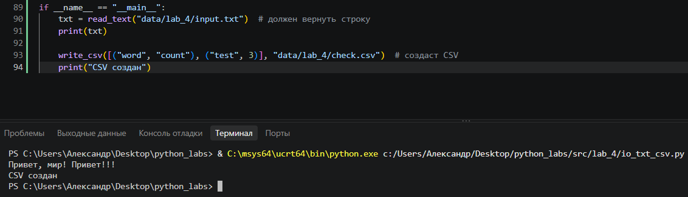
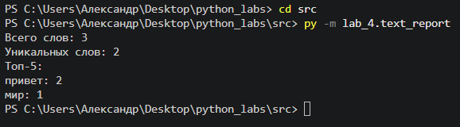
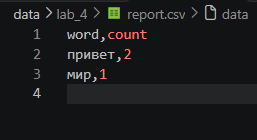
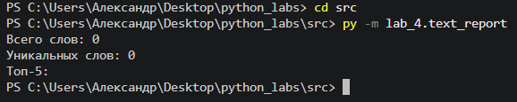
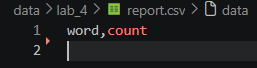
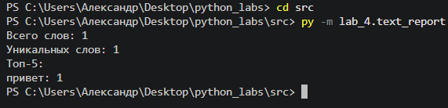
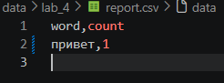

Лабораторная работа № 4

Команды запуска

```powershell
# Задание A
работает без дополнительных команд в терминале

# Задание B
cd src
py -m lab_4.text_report
```

Описание реализации и краевых случаев

* Настройка путей и работа с кодировками: по умолчанию функции и скрипт работают с кодировкой `UTF-8`. Пути к файлам и кодировка задаются через константы `INPUT_PATH`, `OUTPUT_PATH` и `ENCODING` в начале `text_report.py` (либо передаются аргументом `encoding` при вызове `read_text(path, encoding="cp1251")`). Если кодировка файла не совпадает с указанной, перехватывается исключение `UnicodeDecodeError`, выводится сообщение об ошибке и программа завершается с кодом `sys.exit(1)`.
* Политика для пустого входа: если входной файл пустой (или не содержит слов), функция `read_text` возвращает пустую строку `""`. Скрипт `text_report.py` выводит в консоль нулевую статистику (`Всего слов: 0`, `Уникальных слов: 0`), а в выходной файл `report.csv` записывается только заголовок (`word,count`).
* Отсутствие входного файла: если файл по указанному пути не существует (`FileNotFoundError`), скрипт выводит в консоль сообщение об ошибке и завершает работу через `sys.exit(1)`.
* Большие файлы: в рамках лабораторной работы файл читается целиком в память (`Path.read_text`). В реальных задачах при работе с большими файлами (сотни МБ и более) следует использовать построчное чтение, чтобы избежать переполнения оперативной памяти.

Задание A

Результат мини-тестов



Задание B

Тест A (Привет, мир! Привет!!!)




Тест B (пустой файл)




Тест C (Привет в кодировке cp1251)




