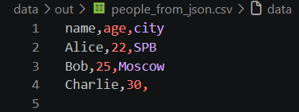
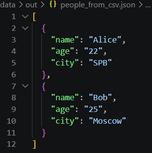
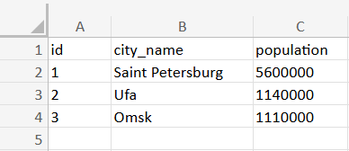

Лабораторная работа № 5

## Команды запуска

```bash
# Задание A
py -m src.lab_5.json_csv

# Задание B
py -m src.lab_5.csv_xlsx

```

---

## Описание функций

### `json_to_csv(json_path: str, csv_path: str) -> None`

1. Проверяет существование входного файла;
2. Проверяет расширение `.json`;
3. Читает JSON в кодировке UTF-8;
4. Проверяет, что корневой объект является непустым списком словарей;
5. Собирает названия всех ключей в порядке их первого появления;
6. Записывает заголовок и строки в CSV в кодировке UTF-8.

Если в одном из словарей отсутствует ключ, `csv.DictWriter` записывает в соответствующую ячейку пустое значение.

---

### `csv_to_json(csv_path: str, json_path: str) -> None`

1. Проверяет существование входного файла;
2. Проверяет расширение `.csv`;
3. Читает CSV в кодировке UTF-8 с помощью `csv.DictReader`;
4. Проверяет наличие непустой строки заголовка и непустого содержимого;
5. Преобразует каждую строку CSV в словарь строковых значений;
6. Записывает полученный список словарей в JSON в кодировке UTF-8 с отступами `indent=2` и параметром `ensure_ascii=False`.

---

### `csv_to_xlsx(csv_path: str, xlsx_path: str) -> None`

1. Проверяет существование входного файла;
2. Проверяет расширение `.csv`;
3. Читает CSV в кодировке UTF-8 и проверяет наличие заголовка и строк данных;
4. Создает книгу Excel и устанавливает активному листу имя `Sheet1`;
5. Построчно переносит данные из CSV на рабочий лист;
6. Вычисляет максимальную длину значения в каждом столбце и задает ширину колонки по формуле `max(max_len + 2, 8)`;
7. Сохраняет сформированную книгу Excel в формате `.xlsx`.

---

## Обработка ошибок

* `FileNotFoundError` — входной файл не найден;
* `ValueError` — расширение файла не соответствует ожидаемому формату;
* `ValueError` — JSON пустой, имеет неподдерживаемую структуру или содержит элементы не-словари;
* `ValueError` — CSV пустой или не содержит строк данных.

---

## Результаты работы

### JSON → CSV

### CSV → JSON

### CSV → XLSX

```
