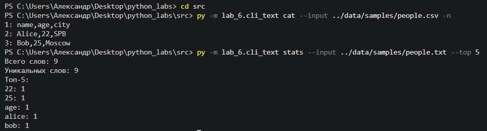
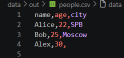
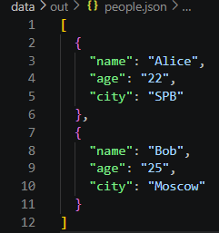
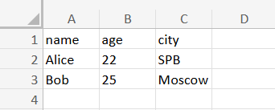
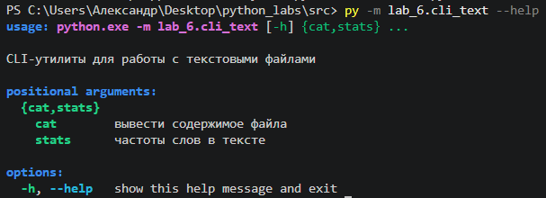

## Лабораторная работа № 6

## Команды запуска

```bash
# Задание A
cd src
py -m lab_6.cli_text cat --input ../data/samples/people.csv -n
py -m lab_6.cli_text stats --input ../data/samples/people.txt --top 5

# Задание B
cd src
py -m lab_6.cli_convert json2csv --in ../data/samples/people.json --out ../data/out/people.csv
py -m lab_6.cli_convert csv2json --in ../data/samples/people.csv --out ../data/out/people.json
py -m lab_6.cli_convert csv2xlsx --in ../data/samples/people.csv --out ../data/out/people.xlsx

# Справка
cd src
py -m lab_6.cli_text stats --help
```

## Обработка ошибок

* `FileNotFoundError` — входной файл по переданному пути не существует;
* `UnicodeDecodeError` — файл содержит недопустимые байты (ожидается UTF-8);
* `OSError` — системная ошибка ввода-вывода или отсутствие прав доступа;
* `json.JSONDecodeError` — файл повреждён или содержит синтаксически некорректный JSON;
* `ValueError` — некорректная внутренняя структура файлов или неверное расширение;
* `parser.error` — отсутствие обязательных параметров командной строки или неположительное значение для флага `--top` (меньше или равно нулю).## Обработка ошибок

* `FileNotFoundError` — входной файл по переданному пути не существует;
* `UnicodeDecodeError` — файл содержит недопустимые байты (ожидается UTF-8);
* `OSError` — системная ошибка ввода-вывода или отсутствие прав доступа;
* `json.JSONDecodeError` — файл повреждён или содержит синтаксически некорректный JSON;
* `ValueError` — некорректная внутренняя структура файлов или неверное расширение;
* `parser.error` — отсутствие обязательных параметров командной строки или неположительное значение для флага `--top` (меньше или равно нулю).

## Задание A

#### `cat(args: argparse.Namespace) -> None`

1. Считывает текст из файла по пути `args.input` с помощью вспомогательной функции `read_text`;
2. Перехватывает системные ошибки чтения (`FileNotFoundError`, `UnicodeDecodeError`, `OSError`), выводит сообщение в поток ошибок `sys.stderr` и завершает работу с кодом `1`;
3. Разбивает полученный текст на строки с помощью `.splitlines()`;
4. При наличии флага `-n` выводит каждую строку с её порядковым номером (`{номер}: {строка}`);
5. Если флаг отсутствует, выводит строки в исходном виде.

#### `stats(args: argparse.Namespace) -> None`

1. Считывает текст из файла по пути `args.input`;
2. Обрабатывает возможные ошибки доступа и кодировки файла аналогично функции `cat`;
3. Нормализует текст через `normalize()` и разбивает его на список токенов через `tokenize()`;
4. Вычисляет частотность слов функцией `count_freq()`;
5. Выводит общее число слов и число уникальных токенов;
6. С помощью функции `top_n()` выводит срез самых частотных слов в количестве `args.top`.



## Задание B

#### `main() -> None`

1. Инициализирует корневой парсер аргументов командной строки и подкоманды: `json2csv`, `csv2json`, `csv2xlsx`;
2. Для каждой подкоманды настраивает флаги путей `--in` (сохраняется как `input`) и `--out` (сохраняется как `output`);
3. В зависимости от переданной команды вызывает соответствующую функцию конвертации из модуля `lab_5`:
* `json_to_csv(args.input, args.output)`
* `csv_to_json(args.input, args.output)`
* `csv_to_xlsx(args.input, args.output)`
4. Отлавливает возможные исключения (`FileNotFoundError`, `json.JSONDecodeError`, `ValueError`), выводит информативное сообщение об ошибке в `sys.stderr` и завершает программу с кодом возврата `1`;
5. При успешном выполнении выводит сообщение о завершении операции.

### JSON → CSV

### CSV → JSON

### CSV → XLSX


## Справка --help
